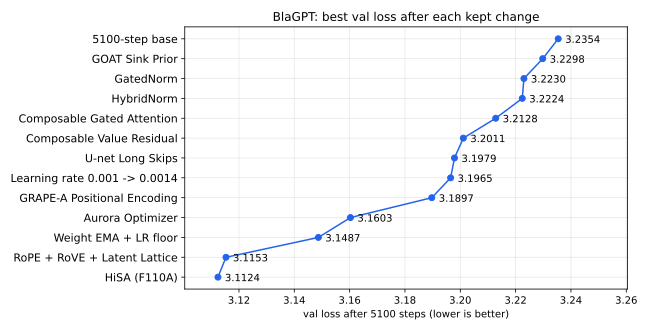

# BlaGPT

A playground to test language model architectures, layers and training tricks on a small budget.
Each new idea goes on top of the best config. It stays only if the final val loss drops.

## 👑 Current best

| Item | Value |
|---|---|
| **Val loss** | **3.1153** (5100 steps, 8x H200) |
| **Model** | 10 layers, d=768, 404.64M params (193M of them in the Engram table) |
| **Main parts** | Latent Lattice · RoPE + RoVE · Aurora optimizer · Engram (vocab ×5) |
| **Speed** | 732 ms/step, peak 70,569 MiB per GPU |
| **Config** | [`best_model_config.py`](./bla_gpt/best_model_config.py) · [`ar/best_config.json`](./ar/best_config.json) |

```bash
torchrun --standalone --nproc_per_node=8 bla_gpt/train.py --run_name best_model --model_name best
```



**Contents:** [Progression](#progression) · [Alternative architectures](#alternative-architectures) · [Byte-level models](#byte-level-models) · [Optimizers](#optimizers) · [Adding a new model](#adding-a-new-model) · [Training](#training) · [Techniques](./techniques/)

## Progression

Each row adds one change to the best model at that time. ✅ = kept, ❌ = discarded, 👑 = current best. — = not recorded in the original run.

| Technique | | Val loss | Δ | Peak MiB | ms/step | Notes |
|---|---|---|---|---|---|---|
| Setting base theta to 1_000_000<br><sub>[llama3](https://github.com/meta-llama/llama3/blob/main/llama/model.py#L49)</sub> | — | 3.3324 | — | — | — | increased the final validation loss |
| Z-loss regularization<br><sub>[link](https://arxiv.org/pdf/2309.14322)</sub> | — | 3.3527 | — | — | — | increased the final validation loss by 0.02 |
| KV-Shifting attention<br><sub>[link](https://arxiv.org/abs/2411.19574)</sub> | — | 3.3138 | -0.0172 | 42858 | — | lower loss than its base (3.3310) |
| Dilated Attention (LongNet)<br><sub>[link](https://arxiv.org/pdf/2307.02486)</sub> | — | — | — | — | — | — |
| Multi-Head Latent Attention<br><sub>[link](https://arxiv.org/abs/2502.07864)</sub> | — | 3.3479 | — | 42192 | — | — |
| Per token output bias | — | 3.3257 | — | 42120 | — | — |
| DyT Norm<br><sub>[link](https://arxiv.org/html/2503.10622v1)</sub> | — | — | — | — | — | loss stayed high; did not train well |
| Forgetting Transformer (Vanilla and Pro vers)<br><sub>[link](https://openreview.net/pdf?id=q2Lnyegkr8)</sub> | — | 3.3243 | — | — | — | vanilla version; the Pro version ran out of memory |
| Multi-Token Attention<br><sub>[link](https://arxiv.org/pdf/2504.00927)</sub> | — | 3.3357 | — | 42136 | — | — |
| Differential Attention<br><sub>[link](https://arxiv.org/abs/2410.05258)</sub> | ❌ | 3.2460 | +0.0049 | 41521 | — | — |
| Softpick<br><sub>[link](https://arxiv.org/abs/2504.20966)</sub> | — | 3.3446 | — | 59417 | — | — |
| Canon Layer<br><sub>[link](https://physics.allen-zhu.com/part-4-architecture-design/part-4-1)</sub> | — | 3.3217 | — | 43199 | — | — |
| Parallel Transformer Block<br><sub>[link](https://arxiv.org/abs/2204.02311)</sub> | — | 3.3473 | — | 40302 | — | — |
| Per Layer Token Embedding<br><sub>[link](https://blog.google/technology/developers/gemma-3/)</sub> | — | 3.2411 | — | 40916 | — | — |
| PolyNorm<br><sub>[link](https://arxiv.org/html/2411.03884v1)</sub> | ❌ | 3.3017 | +0.0606 | 40895 | — | — |
| PolyReLU<br><sub>[link](https://arxiv.org/html/2411.03884v1)</sub> | ❌ | 3.2642 | +0.0231 | 40890 | — | — |
| TOP loss<br><sub>[paper](https://arxiv.org/abs/2508.19228) · [explanation](./techniques/top.md)</sub> | ❌ | 3.2636 | +0.0225 | 47816 | — | — |
| Simplified RoPe<br><sub>[link](https://x.com/zhaisf/status/1999050766691205363?s=20)</sub> | ❌ | 3.2620 | +0.0209 | 43585 | 388.54 | — |
| Gated Attention<br><sub>[paper](https://arxiv.org/abs/2505.06708) · [explanation](./techniques/gated_attention.md)</sub> | ✅ | **3.2327** | -0.0084 | 45968 | 413.01 | — |
| ResFormer (Plus)<br><sub>[paper](https://arxiv.org/html/2410.17897v5) · [explanation](./techniques/resformer.md)</sub> | ❌ | 3.3538 | +0.1211 | 38223 | 326.32 | — |
| Engram (My Simple Variant)<br><sub>[paper](https://github.com/deepseek-ai/Engram/blob/main/Engram_paper.pdf) · [explanation](./techniques/engram.md)</sub> | ✅ | **3.2296** | -0.0031 | 50488 | 504.09 | — |
| Differential Attention v2<br><sub>[paper](https://spiky-homegrown-4cb.notion.site/Differential-Transformer-V2-2e7baa052def80ecaa93d4d67d125417) · [explanation](./techniques/diff_attn_v2.md)</sub> | ✅ | **3.2274** | -0.0022 | 52829 | 535.16 | — |
| Exclusive Self Attention<br><sub>[paper](https://arxiv.org/html/2603.09078v1)</sub> | ✅ | **3.2303** | -0.0024 | 49859 | 424.54 | tested on the Gated Attention base (3.2327), in parallel with the two rows above |
| Hyper-Connections<br><sub>[paper](https://arxiv.org/abs/2409.19606) · [explanation](./techniques/hyper_connections.md)</sub> | ❌ | 3.2741 | +0.0414 | 68729 | 928.26 | tested on the Gated Attention base (3.2327) |
| All keeps combined (5100 steps) | ✅ | **3.2354** | — | — | — | new 5100-step base: all kept techniques above in one config (`ar/full_train/combined_keeps.json`); every row below uses this 5100-step setup |
| GOAT Sink Prior<br><sub>[paper](https://arxiv.org/abs/2601.15380) · [explanation](./techniques/goat_sink_prior.md)</sub> | ✅ | **3.2298** | -0.0056 | 52231 | 377.61 | — |
| GatedNorm<br><sub>[paper](https://arxiv.org/abs/2601.22966) · [explanation](./techniques/gated_norm.md)</sub> | ✅ | **3.2230** | -0.0068 | 50023 | 410.68 | — |
| HybridNorm<br><sub>[paper](https://arxiv.org/abs/2503.04598) · [explanation](./techniques/hybrid_norm.md)</sub> | ✅ | **3.2224** | -0.0006 | 50495 | 474.82 | — |
| Composable Gated Attention<br><sub>[paper](https://arxiv.org/abs/2505.06708) · [explanation](./techniques/composable_gated_attention.md)</sub> | ✅ | **3.2128** | -0.0096 | 58553 | 489.07 | — |
| Composable Value Residual<br><sub>[paper](https://arxiv.org/abs/2410.17897) · [explanation](./techniques/value_residual.md)</sub> | ✅ | **3.2011** | -0.0117 | 58988 | 497.55 | — |
| U-net Long Skips<br><sub>[source](https://github.com/KellerJordan/modded-nanogpt) · [explanation](./techniques/unet_skips.md)</sub> | ✅ | **3.1979** | -0.0032 | 58632 | 494.31 | — |
| Learning rate 0.001 -> 0.0014<br><sub>[Muon source](https://kellerjordan.github.io/posts/muon/)</sub> | ✅ | **3.1965** | -0.0014 | 58632 | 491.00 | — |
| GRAPE-A Positional Encoding<br><sub>[paper](https://arxiv.org/abs/2512.07805) · [explanation](./techniques/grape_a_qgate.md)</sub> | ✅ | **3.1897** | -0.0068 | 59643 | 580.32 | replaces RoPE; later replaced again by RoPE + RoVE |
| Aurora Optimizer<br><sub>[paper](https://arxiv.org/abs/2606.27715) · [explanation](./techniques/aurora.md)</sub> | ✅ | **3.1603** | -0.0294 | 59643 | 721.25 | replaces Muon, `learning_rate=0.03` |
| Weight EMA + LR floor | ✅ | **3.1487** | -0.0116 | 61239 | 731.65 | LR decays to 15% of peak, not to 0, and eval uses the average weights of the last 300 steps; removed in F107b_e5 |
| Token normalization for Engram<br><sub>[PR #375](https://github.com/KellerJordan/modded-nanogpt/pull/375) · [explanation](./techniques/engram.md)</sub> | ❌ | 3.1564 | -0.0039 | 59643 | 719.88 | tested on the Aurora base (3.1603), in parallel with Weight EMA + LR floor; tokens with the same first 2 bytes share one Engram entry; off by default |
| RoPE + RoVE + Latent Lattice (F107b_e5)<br><sub>[RoPE](https://arxiv.org/abs/2104.09864) · [RoVE](https://arxiv.org/abs/2606.11275) · [Latent Lattice](https://arxiv.org/abs/2611.21608) · [explanation](./techniques/latent_lattice.md)</sub> | 👑 | **3.1153** | -0.0334 | 70569 | 732.44 | 404.64M params; RoPE + RoVE replace GRAPE-A; one recurrent latent (width 256) on layers 2-7 modulates q/k/v and the MLP (FiLM after the QK norm, Lattice params in AdamW lr 1e-3, vstream); weight EMA and LR floor removed; second seed: `3.1230` |

Early techniques with no recorded loss: [Multi-token prediction](https://arxiv.org/pdf/2404.19737) · [Weight tying](https://arxiv.org/abs/1608.05859v3) · [Grouped query attention](https://arxiv.org/pdf/2305.13245) · [Capping logits](https://arxiv.org/pdf/2408.00118) · [QKV bias](https://arxiv.org/abs/2407.10671) · [Zero-init projection layer](https://arxiv.org/abs/2407.10671) · [Post and pre-RMSNorm](https://arxiv.org/pdf/2408.00118).

Run logs: `ar/full_results.tsv` (full runs), `ar/results.tsv` (short runs), `ar/best_config.json` (best config). Technique notes: [`techniques/`](./techniques/).

## Alternative Architectures

| Model | Val loss | Peak MiB | ms/step | Notes |
|---|---|---|---|---|
| MegaByte<br><sub>[link](https://arxiv.org/abs/2305.07185)</sub> | 3.810 | — | — | — |
| FTP (heavily modified)<br><sub>[link](https://arxiv.org/pdf/2410.18160)</sub> | 3.901 | — | — | — |
| Rene<br><sub>[link](https://huggingface.co/cartesia-ai/Rene-v0.1-1.3b-pytorch)</sub> | 3.340 | — | — | — |
| Rwkv7<br><sub>[link](https://github.com/BlinkDL/RWKV-LM)</sub> | 4.450 | — | — | — |
| Zamba2<br><sub>[link](https://huggingface.co/Zyphra/Zamba2-2.7B)</sub> | — | — | — | no loss recorded; ranked Zamba2 > Rene > Rwkv7 |
| Hourglass Transformer (modified)<br><sub>[link](https://arxiv.org/abs/2110.13711)</sub> | 3.710 | — | — | token-level run; ranked Hourglass > MegaByte > FTP |
| Hymba<br><sub>[link](https://arxiv.org/html/2411.13676v1)</sub> | 4.7505 | — | — | much slower per step than the Transformer |
| Tokenformer (in BlaGPT model)<br><sub>[link](https://github.com/Haiyang-W/TokenFormer)</sub> | 3.390 | — | — | — |
| LLaDa (dLLM)<br><sub>[link](https://arxiv.org/abs/2502.09992)</sub> | 8.6930 | — | — | diffusion loss; cross-entropy `4.2891` compares with the other models (from `bla_gpt/llada_validation_cross_entropy.py`) |
| Avey<br><sub>[link](https://arxiv.org/pdf/2506.11305v1)</sub> | 3.323 | 51962 | 2871 | batch size 8; very slow to train; more than 3x the memory of other models |
| LFM2<br><sub>[link](https://huggingface.co/LiquidAI/LFM2-1.2B)</sub> | — | — | — | TBD |
| Kimi Delta Attention (1:3 interleaved Full Attention)<br><sub>[link](https://arxiv.org/abs/2510.26692)</sub> | 3.2411→3.2532 | 47391 | 568.1 | — |

## Byte-Level Models

Val loss here is per byte, not per BPE token. Do not compare it with the tables above.

| Model | Val loss | Peak MiB | ms/step | Notes |
|---|---|---|---|---|
| Hourglass Transformer (modified)<br><sub>[link](https://arxiv.org/abs/2110.13711)</sub> | 1.0048 | — | 524.76 | byte-level run of the token-level model above |
| AUNet<br><sub>[link](https://arxiv.org/abs/2506.14761)</sub> | 1.1502 | — | 1423.60 | — |
| SpaceByte<br><sub>[link](https://arxiv.org/abs/2404.14408)</sub> | 1.6755 | 27781 | 423.36 | — |
| HNet<br><sub>[link](https://arxiv.org/pdf/2507.07955)</sub> | 1.4554 | 23948 | 433.75 | — |

## Optimizers

| Optimizer | Val loss | Peak MiB | ms/step | Notes |
|---|---|---|---|---|
| PaLMForeachSOAP<br><sub>[link](https://github.com/ClashLuke/HeavyBall)</sub> | — | — | — | best loss of the early optimizers, but almost 2x slower than Adam |
| Ademamix<br><sub>[link](https://github.com/nanowell/AdEMAMix-Optimizer-Pytorch/blob/main/AdEMAMix.py)</sub> | — | — | — | unstable at all tested learning rates |
| Adopt<br><sub>[link](https://github.com/iShohei220/adopt)</sub> | — | — | — | loss became NaN |
| CAdamW<br><sub>[link](https://github.com/kyleliang919/C-Optim/blob/main/c_adamw.py)</sub> | 3.3517 | — | — | — |
| AdamW with independent weight decay<br><sub>[link](https://arxiv.org/pdf/2309.14322)</sub> | 3.320 | — | — | — |
| Adam | 3.3224 | — | — | — |
| AdamW | 3.3310 | 42053 | 533 | — |
| DeMo<br><sub>[link](https://arxiv.org/abs/2411.19870)</sub> | 3.4676 | 41534 | 820 | saves 7 GB per GPU; higher loss and slower steps than Adam |
| Adam-Mini | 3.3324 | 41534 | 610 | higher loss and slower steps than Adam and AdamW; saves a little memory |
| MARS<br><sub>[link](https://github.com/AGI-Arena/MARS)</sub> | 3.3459 | 40953 | 628 | — |
| Muon<br><sub>[link](https://kellerjordan.github.io/posts/muon/)</sub> | 3.2923 | 40332 | 620.24 | — |
| AdaMuon<br><sub>[paper](https://arxiv.org/abs/2507.11005) · [explanation](./techniques/adamuon.md)</sub> | — | — | — | Adaptive Muon with second-moment estimation |
| Aurora<br><sub>[paper](https://arxiv.org/abs/2606.27715) · [tilde-research/aurora-release](https://github.com/tilde-research/aurora-release)</sub> | 3.1897→3.1603 | 59643 | 721 | matrix weights use Aurora, other weights use AdamW; `lr=0.03, weight_decay=0.025` |
| BiClip<br><sub>[link](https://arxiv.org/pdf/2502.04164)</sub> | 7.2292 | 39751 | 510 | did not train well |
| NorMuon<br><sub>[paper](https://arxiv.org/html/2510.05491v1) · [explanation](./techniques/normuon.md)</sub> | 3.2411→3.4630 | 44154 | 387.46 | — |
| Cautious Weight Decay<br><sub>[paper](https://arxiv.org/pdf/2510.12402v1) · [explanation](./techniques/cautious_weight_decay.md)</sub> | 3.2327→3.2334 | 45971 | 434.2 | — |

## Adding a New Model

- Implement the model. The forward function must return the loss.
- Add a function `register_<name>` with the `@register_model` decorator in [`bla_gpt/model_registers.py`](./bla_gpt/model_registers.py).
- Start training with `--model_name <name>`.

See the existing functions in `model_registers.py` for examples.

## Training

<details>
<summary>Training scripts, quick start, datasets, tokenizers, LR finder</summary>

BlaGPT provides two training scripts:

| Script | Purpose | Data Sources |
|--------|---------|--------------|
| `train.py` | Quick experimentation with pre-tokenized data | Binary shards only |
| `train_flex.py` | Flexible training with custom datasets/tokenizers | Binary shards, HF streaming, byte-level |

### Quick Start (train.py)

For rapid architecture benchmarking with the default FineWeb10B dataset:

```bash
# Get the pre-tokenized data
python data/fineweb10B_cached.py

# Start training
torchrun --standalone --nproc_per_node=8 bla_gpt/train.py --run_name my_experiment --model_name blagpt
```

### Flexible Training (train_flex.py)

For custom datasets, different tokenizers, or HuggingFace streaming:

#### Using Pre-tokenized Binary Shards (Default)

```bash
torchrun --standalone --nproc_per_node=8 bla_gpt/train_flex.py \
    --model_name blagpt \
    --run_name my_experiment
```

#### Using HuggingFace Streaming Datasets

Stream data directly from HuggingFace Hub - no pre-download required:

```bash
# FineWeb with GPT-2 tokenizer (tiktoken)
torchrun --standalone --nproc_per_node=8 bla_gpt/train_flex.py \
    --model_name blagpt \
    --run_name hf_streaming_test \
    --use_hf_streaming \
    --hf_dataset "HuggingFaceFW/fineweb" \
    --hf_dataset_config "sample-10BT"

# C4 dataset with HuggingFace tokenizer
torchrun --standalone --nproc_per_node=8 bla_gpt/train_flex.py \
    --model_name blagpt \
    --run_name c4_experiment \
    --use_hf_streaming \
    --hf_dataset "allenai/c4" \
    --hf_dataset_config "en" \
    --tokenizer_backend huggingface \
    --tokenizer_name "gpt2"

# Custom dataset with custom text column
torchrun --standalone --nproc_per_node=8 bla_gpt/train_flex.py \
    --model_name blagpt \
    --run_name custom_data \
    --use_hf_streaming \
    --hf_dataset "username/my-dataset" \
    --hf_text_column "content"
```

#### Dataset Options

| Option | Default | Description |
|--------|---------|-------------|
| `--use_hf_streaming` | `False` | Enable HuggingFace streaming mode |
| `--hf_dataset` | `HuggingFaceFW/fineweb` | HuggingFace dataset name or path |
| `--hf_dataset_config` | `sample-10BT` | Dataset configuration/subset |
| `--hf_split` | `train` | Training split name |
| `--hf_text_column` | `text` | Column containing text data |
| `--hf_val_dataset` | Same as train | Separate validation dataset (optional) |
| `--hf_val_dataset_config` | Same as train | Validation dataset config |
| `--hf_val_split` | `train` | Validation split name |
| `--hf_val_samples` | `1000` | Number of samples for validation (first N of val split) |
| `--hf_shuffle_buffer` | `10000` | Shuffle buffer size for streaming |

**Train/Validation Split:** By default, the first 1000 samples are used for validation and training skips these samples (no overlap). When using a separate validation dataset or split, this behavior is automatically disabled.

#### Tokenizer Options

| Option | Default | Description |
|--------|---------|-------------|
| `--tokenizer_backend` | `tiktoken` | Backend: `tiktoken` or `huggingface` |
| `--tokenizer_name` | `gpt2` | Tokenizer name (encoding or model path) |

**tiktoken encodings:** `gpt2`, `cl100k_base`, `o200k_base`

**HuggingFace tokenizers:** Any model name, e.g., `meta-llama/Llama-2-7b-hf`, `mistralai/Mistral-7B-v0.1`

### Learning Rate Finder (Optional)

Run before training to find optimal learning rate:

```bash
torchrun --standalone --nproc_per_node=8 bla_gpt/find_lr.py --model_name blagpt

# Output
Results:
Steepest gradient learning rate: 3.31e-06
Elbow point learning rate: 1.20e-01
Plot saved to: logs/lr_finder_blagpt/lr_finder_plot.png
Results saved to: logs/lr_finder_blagpt/lr_finder_results.pt
```

</details>

## Acknowledgements

The initial code is based on

Nano GPT - [link](https://github.com/karpathy/nanoGPT)

Modded NanoGPT - [link](https://github.com/KellerJordan/modded-nanogpt)

Thanks to @xumingyu2021 for memory friendly implementation of the Differential Attention
